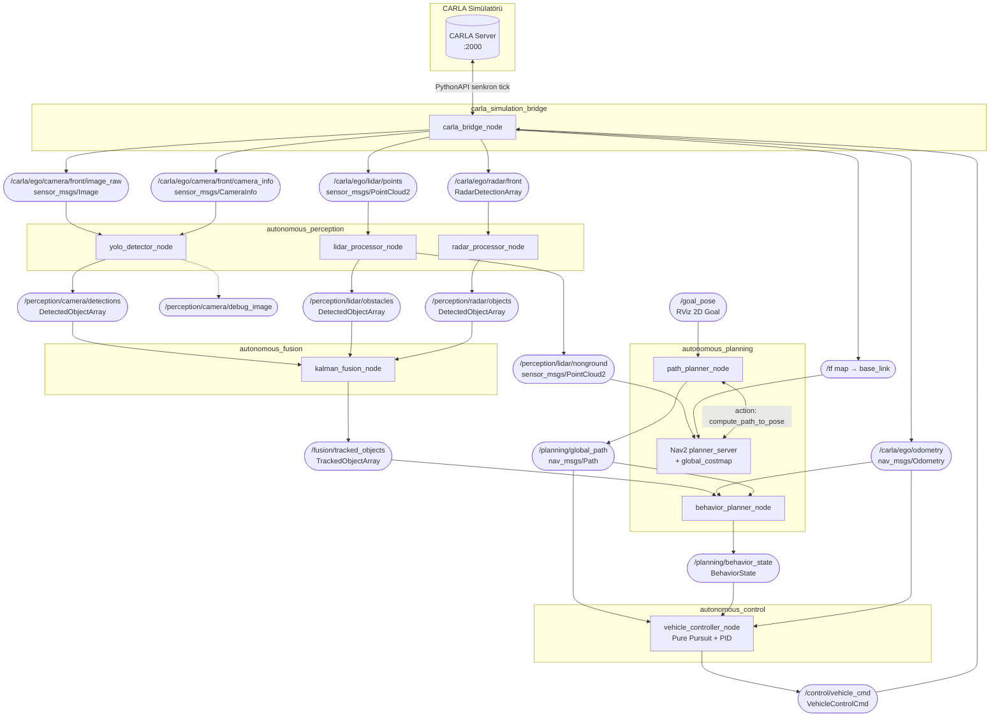
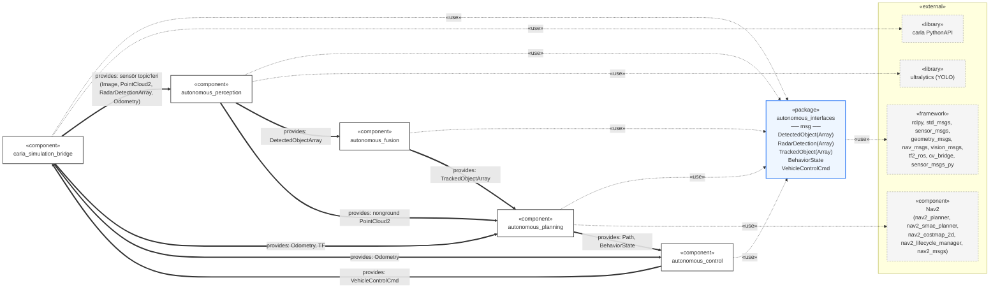

# Sistem Mimarisi

ROS 2 + CARLA tabanlı otonom araç simülasyon yığını. Veri akışı tek yönlü bir boru hattı izler:

```
CARLA Simülatörü → Perception (Kamera + YOLO, LiDAR, Radar) → Sensor Fusion (Kalman Filtresi) → Planning & Control (Nav2, Path, Behaviors, Control)
```

Kontrol komutu döngüyü kapatarak tekrar CARLA'ya geri döner.

## (a) Klasör Ağacı

```text
GProject/
├── docs/
│   └── architecture.md
├── README.md
└── src/
    ├── autonomous_interfaces/            # ament_cmake – ortak mesaj tanımları
    │   ├── CMakeLists.txt
    │   ├── package.xml
    │   └── msg/
    │       ├── DetectedObject.msg
    │       ├── DetectedObjectArray.msg
    │       ├── RadarDetection.msg
    │       ├── RadarDetectionArray.msg
    │       ├── TrackedObject.msg
    │       ├── TrackedObjectArray.msg
    │       ├── BehaviorState.msg
    │       └── VehicleControlCmd.msg
    ├── carla_simulation_bridge/          # ament_python – CARLA <-> ROS 2 köprüsü
    │   ├── package.xml, setup.py, setup.cfg, resource/
    │   ├── carla_simulation_bridge/
    │   │   └── carla_bridge_node.py
    │   ├── config/carla_bridge.yaml
    │   └── launch/carla_bridge.launch.py
    ├── autonomous_perception/            # ament_python – algılama
    │   ├── package.xml, setup.py, setup.cfg, resource/
    │   ├── autonomous_perception/
    │   │   ├── yolo_detector_node.py
    │   │   ├── lidar_processor_node.py
    │   │   └── radar_processor_node.py
    │   ├── config/perception.yaml
    │   └── launch/perception.launch.py
    ├── autonomous_fusion/                # ament_python – sensör füzyonu
    │   ├── package.xml, setup.py, setup.cfg, resource/
    │   ├── autonomous_fusion/
    │   │   ├── kalman_filter.py          # CV-Kalman + çoklu nesne takibi (ROS'tan bağımsız)
    │   │   └── kalman_fusion_node.py
    │   ├── config/fusion.yaml
    │   ├── launch/fusion.launch.py
    │   └── test/test_kalman_filter.py
    ├── autonomous_planning/              # ament_python – Nav2 + davranış planlama
    │   ├── package.xml, setup.py, setup.cfg, resource/
    │   ├── autonomous_planning/
    │   │   ├── path_planner_node.py
    │   │   └── behavior_planner_node.py
    │   ├── config/nav2_params.yaml
    │   ├── launch/planning.launch.py
    │   └── test/test_behavior.py
    └── autonomous_control/               # ament_python – araç kontrolü
        ├── package.xml, setup.py, setup.cfg, resource/
        ├── autonomous_control/
        │   ├── controllers.py            # Pure Pursuit + PID (ROS'tan bağımsız)
        │   └── vehicle_controller_node.py
        ├── config/control.yaml
        ├── launch/control.launch.py
        └── test/test_controllers.py
```

## (b) ROS 2 Düğümleri ve Topic Veri Akışı

Dikdörtgenler düğümleri, yuvarlatılmış kutular topic'leri gösterir. Nav2 ile iletişim bir action (`compute_path_to_pose`) üzerinden yapılır.



### Topic özeti

| Topic | Tip | Yayıncı | Abone(ler) |
|---|---|---|---|
| `/carla/ego/camera/front/image_raw` | `sensor_msgs/Image` | carla_bridge_node | yolo_detector_node |
| `/carla/ego/camera/front/camera_info` | `sensor_msgs/CameraInfo` | carla_bridge_node | yolo_detector_node |
| `/carla/ego/lidar/points` | `sensor_msgs/PointCloud2` | carla_bridge_node | lidar_processor_node |
| `/carla/ego/radar/front` | `autonomous_interfaces/RadarDetectionArray` | carla_bridge_node | radar_processor_node |
| `/carla/ego/odometry` | `nav_msgs/Odometry` | carla_bridge_node | behavior_planner_node, vehicle_controller_node |
| `/perception/camera/detections` | `autonomous_interfaces/DetectedObjectArray` | yolo_detector_node | kalman_fusion_node |
| `/perception/lidar/obstacles` | `autonomous_interfaces/DetectedObjectArray` | lidar_processor_node | kalman_fusion_node |
| `/perception/lidar/nonground` | `sensor_msgs/PointCloud2` | lidar_processor_node | Nav2 global_costmap |
| `/perception/radar/objects` | `autonomous_interfaces/DetectedObjectArray` | radar_processor_node | kalman_fusion_node |
| `/fusion/tracked_objects` | `autonomous_interfaces/TrackedObjectArray` | kalman_fusion_node | behavior_planner_node |
| `/goal_pose` | `geometry_msgs/PoseStamped` | RViz / kullanıcı | path_planner_node |
| `/planning/global_path` | `nav_msgs/Path` | path_planner_node | behavior_planner_node, vehicle_controller_node |
| `/planning/behavior_state` | `autonomous_interfaces/BehaviorState` | behavior_planner_node | vehicle_controller_node |
| `/control/vehicle_cmd` | `autonomous_interfaces/VehicleControlCmd` | vehicle_controller_node | carla_bridge_node |

### Füzyon stratejisi

- **LiDAR** kümeleri iz (track) oluşturur ve konumu günceller (en hassas konum kaynağı).
- **Radar** mevcut izlerin konumunu ve Doppler (radyal hız) ölçümüyle hızını düzeltir.
- **Kamera (YOLO)** mesafe vermez; tespitin açısı (bearing) en yakın ize eşlenerek sınıf etiketi atanır.
- Durum vektörü `[x, y, vx, vy]`, sabit hız modeli, χ² kapılamalı en yakın komşu eşlemesi.

## (c) Paketler Arası Bağımlılıklar (UML Component Diyagramı)

Tüm uygulama paketleri yalnızca ortak `autonomous_interfaces` paketine **derleme/çalışma zamanı** bağımlılığı taşır; aralarındaki bağlantılar ise doğrudan import değil, **topic arayüzleri** üzerindendir. Bu sayede her katman bağımsız test edilip değiştirilebilir.



**Gösterim:** kesikli ok (`-.->`) = `package.xml` içindeki «use» bağımlılığı, kalın ok (`==>`) = topic üzerinden sağlanan arayüz (çalışma zamanı veri akışı).

### Bağımlılık matrisi (`package.xml`)

| Paket | Build tipi | autonomous_interfaces | Dış bağımlılıklar |
|---|---|:---:|---|
| `autonomous_interfaces` | ament_cmake | – | std_msgs, geometry_msgs, vision_msgs, rosidl |
| `carla_simulation_bridge` | ament_python | ✔ | rclpy, sensor_msgs, nav_msgs, tf2_ros, cv_bridge, **carla** |
| `autonomous_perception` | ament_python | ✔ | rclpy, sensor_msgs, vision_msgs, cv_bridge, sensor_msgs_py, **ultralytics** |
| `autonomous_fusion` | ament_python | ✔ | rclpy, sensor_msgs, numpy |
| `autonomous_planning` | ament_python | ✔ | rclpy, nav_msgs, **nav2_\*** |
| `autonomous_control` | ament_python | ✔ | rclpy, nav_msgs |

## Derleme ve Çalıştırma

```bash
# Ubuntu 22.04 + ROS 2 Humble (veya 24.04 + Jazzy), CARLA 0.9.15 sunucusu çalışır durumda
pip install carla==0.9.15 ultralytics
rosdep install --from-paths src --ignore-src -y
colcon build --symlink-install
source install/setup.bash

ros2 launch carla_simulation_bridge carla_bridge.launch.py
ros2 launch autonomous_perception perception.launch.py
ros2 launch autonomous_fusion fusion.launch.py
ros2 launch autonomous_planning planning.launch.py
ros2 launch autonomous_control control.launch.py
# RViz'de "2D Goal Pose" ile /goal_pose gönderin

colcon test && colcon test-result --verbose
```

## Bilinen sınırlamalar / sonraki adımlar

- Füzyon izleri `base_link` (ego-göreli) çerçevesinde tutuluyor; lokalizasyon eklendiğinde `map` çerçevesine taşınmalı.
- Tüm katmanları tek komutla başlatacak bir `autonomous_bringup` paketi (birleşik launch + RViz config) eklenmeli.
- Kamera-LiDAR eşlemesi yalnızca açıya dayanıyor; ileride LiDAR noktalarının görüntüye projeksiyonu ile güçlendirilebilir.
- Şerit değiştirme durumları (`LANE_CHANGE_*`) mesajda tanımlı ancak davranış planlayıcıda henüz kullanılmıyor.
